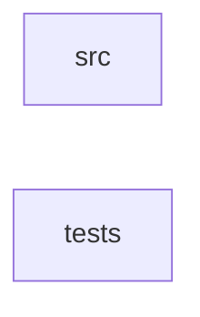

_Generated by CodeAtlas._

## Details

Owns 0 symbols across 1 file(s).

### src

Owns 8 symbols across 1 file(s).

**Related Classes/Methods:** _None_

**Source Files:**

- `crates/contextfold-cli/src/main.rs`
  - `crates.contextfold-cli.src.main.Cli`
  - `crates.contextfold-cli.src.main.emit_report`
  - `crates.contextfold-cli.src.main.fold`
  - `crates.contextfold-cli.src.main.main`
  - `crates.contextfold-cli.src.main.parse_language`
  - `crates.contextfold-cli.src.main.profile_names`
  - `crates.contextfold-cli.src.main.run`
  - `crates.contextfold-cli.src.main.write_out`

### tests

Owns 8 symbols across 1 file(s).

**Related Classes/Methods:** _None_

**Source Files:**

- `crates/contextfold-cli/tests/cli.rs`
  - `crates.contextfold-cli.tests.cli.in_place_overwrites_input`
  - `crates.contextfold-cli.tests.cli.multiple_inputs_without_output_dir_is_error`
  - `crates.contextfold-cli.tests.cli.output_dir_writes_all_inputs`
  - `crates.contextfold-cli.tests.cli.report_json_is_written`
  - `crates.contextfold-cli.tests.cli.run_stdin`
  - `crates.contextfold-cli.tests.cli.stdin_default_profile_is_safe`
  - `crates.contextfold-cli.tests.cli.stdin_safe_profile`
  - `crates.contextfold-cli.tests.cli.unknown_profile_is_rejected`
