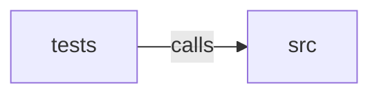

_Generated by CodeAtlas._

## Details

Owns 0 symbols across 1 file(s).

### src

Owns 141 symbols across 11 file(s).

**Related Classes/Methods:** _None_

**Source Files:**

- `crates/contextfold-core/src/analyzer.rs`
  - `crates.contextfold-core.src.analyzer.Analysis`
  - `crates.contextfold-core.src.analyzer.Analysis.empty`
  - `crates.contextfold-core.src.analyzer.Declaration`
  - `crates.contextfold-core.src.analyzer.DeclarationKind`
  - `crates.contextfold-core.src.analyzer.LanguageAnalyzer`
  - `crates.contextfold-core.src.analyzer.Registry`
  - `crates.contextfold-core.src.analyzer.Registry.detect_and_get`
  - `crates.contextfold-core.src.analyzer.Registry.get`
  - `crates.contextfold-core.src.analyzer.Registry.languages`
  - `crates.contextfold-core.src.analyzer.Registry.new`
  - `crates.contextfold-core.src.analyzer.Registry.register`
  - `crates.contextfold-core.src.analyzer.detect_language`
  - `crates.contextfold-core.src.analyzer.language_from_content`
  - `crates.contextfold-core.src.analyzer.language_from_extension`
  - `crates.contextfold-core.src.analyzer.line_looks_like_log`
  - `crates.contextfold-core.src.analyzer.looks_like_log`
  - `crates.contextfold-core.src.analyzer.looks_like_markdown`
- `crates/contextfold-core/src/edit.rs`
  - `crates.contextfold-core.src.edit.ApplyOutcome`
  - `crates.contextfold-core.src.edit.Edit`
  - `crates.contextfold-core.src.edit.Edit.remove`
  - `crates.contextfold-core.src.edit.Edit.replace`
  - `crates.contextfold-core.src.edit.LineIndex`
  - `crates.contextfold-core.src.edit.LineIndex.content`
  - `crates.contextfold-core.src.edit.LineIndex.content_span`
  - `crates.contextfold-core.src.edit.LineIndex.full_span`
  - `crates.contextfold-core.src.edit.LineIndex.has_trailing_newline`
  - `crates.contextfold-core.src.edit.LineIndex.is_blank`
  - `crates.contextfold-core.src.edit.LineIndex.is_empty`
  - `crates.contextfold-core.src.edit.LineIndex.len`
  - `crates.contextfold-core.src.edit.LineIndex.line_of`
  - `crates.contextfold-core.src.edit.LineIndex.new`
  - `crates.contextfold-core.src.edit.LineIndex.source`
  - `crates.contextfold-core.src.edit.OffsetMap`
  - `crates.contextfold-core.src.edit.OffsetMap.identity`
  - `crates.contextfold-core.src.edit.OffsetMap.map`
  - `crates.contextfold-core.src.edit.OffsetMap.map_span`
  - `crates.contextfold-core.src.edit.OffsetMap.new_len`
  - `crates.contextfold-core.src.edit.OffsetMap.orig_len`
  - `crates.contextfold-core.src.edit.apply_edits`
  - `crates.contextfold-core.src.edit.expand_to_lines`
  - `crates.contextfold-core.src.edit.merge_spans`
  - `crates.contextfold-core.src.edit.overlaps_any`
  - `crates.contextfold-core.src.edit.overlaps_sorted`
- `crates/contextfold-core/src/engine.rs`
  - `crates.contextfold-core.src.engine.Engine`
  - `crates.contextfold-core.src.engine.Engine.bare`
  - `crates.contextfold-core.src.engine.Engine.default`
  - `crates.contextfold-core.src.engine.Engine.fold`
  - `crates.contextfold-core.src.engine.Engine.fold_safe`
  - `crates.contextfold-core.src.engine.Engine.has_language`
  - `crates.contextfold-core.src.engine.Engine.new`
  - `crates.contextfold-core.src.engine.Engine.registry`
  - `crates.contextfold-core.src.engine._fold_error_is_send_sync`
  - `crates.contextfold-core.src.engine._fold_error_is_send_sync.assert`
  - `crates.contextfold-core.src.engine.dedupe_records`
  - `crates.contextfold-core.src.engine.metric_name`
  - `crates.contextfold-core.src.engine.noop`
- `crates/contextfold-core/src/error.rs`
  - `crates.contextfold-core.src.error.EngineError`
- `crates/contextfold-core/src/lang.rs`
  - `crates.contextfold-core.src.lang.LanguageId`
  - `crates.contextfold-core.src.lang.LanguageId.as_str`
  - `crates.contextfold-core.src.lang.LanguageId.is_code`
  - `crates.contextfold-core.src.lang.Span`
  - `crates.contextfold-core.src.lang.Span.contains`
  - `crates.contextfold-core.src.lang.Span.is_empty`
  - `crates.contextfold-core.src.lang.Span.len`
  - `crates.contextfold-core.src.lang.Span.new`
  - `crates.contextfold-core.src.lang.Span.overlaps`
- `crates/contextfold-core/src/model.rs`
  - `crates.contextfold-core.src.model.EquivalenceClaim`
  - `crates.contextfold-core.src.model.EquivalenceClaim.as_str`
  - `crates.contextfold-core.src.model.FoldRequest`
  - `crates.contextfold-core.src.model.FoldRequest.new`
  - `crates.contextfold-core.src.model.FoldRequest.with_budget`
  - `crates.contextfold-core.src.model.FoldRequest.with_language`
  - `crates.contextfold-core.src.model.FoldRequest.with_overrides`
  - `crates.contextfold-core.src.model.FoldRequest.with_path`
  - `crates.contextfold-core.src.model.FoldRequest.with_profile`
  - `crates.contextfold-core.src.model.FoldRequest.with_protected_ranges`
  - `crates.contextfold-core.src.model.FoldResult`
  - `crates.contextfold-core.src.model.FoldResult.is_lossy`
  - `crates.contextfold-core.src.model.ParseStatus`
  - `crates.contextfold-core.src.model.ParseStatus.as_str`
  - `crates.contextfold-core.src.model.Report`
  - `crates.contextfold-core.src.model.SizeStats`
  - `crates.contextfold-core.src.model.SizeStats.of`
  - `crates.contextfold-core.src.model.Warning`
  - `crates.contextfold-core.src.model.Warning.new`
  - `crates.contextfold-core.src.model.count_lines`
- `crates/contextfold-core/src/profile.rs`
  - `crates.contextfold-core.src.profile.BlankLineMode`
  - `crates.contextfold-core.src.profile.CommentMode`
  - `crates.contextfold-core.src.profile.LossPolicy`
  - `crates.contextfold-core.src.profile.PreservationOverrides`
  - `crates.contextfold-core.src.profile.PreservationPolicy`
  - `crates.contextfold-core.src.profile.PreservationPolicy.default`
  - `crates.contextfold-core.src.profile.Profile`
  - `crates.contextfold-core.src.profile.Profile.named`
  - `crates.contextfold-core.src.profile.Profile.named_with_overrides`
  - `crates.contextfold-core.src.profile.Profile.names`
  - `crates.contextfold-core.src.profile.ProfileOverrides`
  - `crates.contextfold-core.src.profile.RuleOverrides`
  - `crates.contextfold-core.src.profile.RuleSet`
  - `crates.contextfold-core.src.profile.RuleSet.default`
- `crates/contextfold-core/src/rules.rs`
  - `crates.contextfold-core.src.rules.RuleId`
  - `crates.contextfold-core.src.rules.RuleId.as_str`
  - `crates.contextfold-core.src.rules.RuleId.description`
  - `crates.contextfold-core.src.rules.RuleId.is_lossy`
  - `crates.contextfold-core.src.rules.RuleRecord`
  - `crates.contextfold-core.src.rules.RuleRecord.new`
- `crates/contextfold-core/src/tokenizer.rs`
  - `crates.contextfold-core.src.tokenizer.Budget`
  - `crates.contextfold-core.src.tokenizer.Budget.bytes`
  - `crates.contextfold-core.src.tokenizer.Budget.characters`
  - `crates.contextfold-core.src.tokenizer.Budget.measure`
  - `crates.contextfold-core.src.tokenizer.Budget.tokens`
  - `crates.contextfold-core.src.tokenizer.BudgetMetric`
  - `crates.contextfold-core.src.tokenizer.BudgetReport`
  - `crates.contextfold-core.src.tokenizer.Tokenizer`
- `crates/contextfold-core/src/transform.rs`
  - `crates.contextfold-core.src.transform.TransformOutcome`
  - `crates.contextfold-core.src.transform.TransformOutcome.noop`
  - `crates.contextfold-core.src.transform.blank_line_edits`
  - `crates.contextfold-core.src.transform.body_is_empty`
  - `crates.contextfold-core.src.transform.build_records`
  - `crates.contextfold-core.src.transform.collapse_log_edits`
  - `crates.contextfold-core.src.transform.dedupe_candidate`
  - `crates.contextfold-core.src.transform.hard_protected`
  - `crates.contextfold-core.src.transform.is_hspace`
  - `crates.contextfold-core.src.transform.is_multiline`
  - `crates.contextfold-core.src.transform.line_in_multiline_sorted`
  - `crates.contextfold-core.src.transform.markdown_dedupe_edits`
  - `crates.contextfold-core.src.transform.markdown_fence_spans`
  - `crates.contextfold-core.src.transform.multiline_index`
  - `crates.contextfold-core.src.transform.normalize_log_key`
  - `crates.contextfold-core.src.transform.placeholder_for`
  - `crates.contextfold-core.src.transform.record_from_edits`
  - `crates.contextfold-core.src.transform.removable_span`
  - `crates.contextfold-core.src.transform.strip_level`
  - `crates.contextfold-core.src.transform.strip_timestamp`
  - `crates.contextfold-core.src.transform.transform_code`
  - `crates.contextfold-core.src.transform.transform_json`
  - `crates.contextfold-core.src.transform.transform_log`
  - `crates.contextfold-core.src.transform.transform_markdown`
  - `crates.contextfold-core.src.transform.transform_text`
  - `crates.contextfold-core.src.transform.trim_trailing_edits`
  - `crates.contextfold-core.src.transform.whole_line_removal`

### tests

Owns 24 symbols across 3 file(s).

**Related Classes/Methods:** _None_

**Source Files:**

- `crates/contextfold-core/tests/core_tests.rs`
  - `crates.contextfold-core.tests.core_tests.ByteTokenizer`
  - `crates.contextfold-core.tests.core_tests.ByteTokenizer.count`
  - `crates.contextfold-core.tests.core_tests.ByteTokenizer.name`
  - `crates.contextfold-core.tests.core_tests.apply_edits_drops_overlaps_deterministically`
  - `crates.contextfold-core.tests.core_tests.apply_edits_identity_when_empty`
  - `crates.contextfold-core.tests.core_tests.apply_edits_removes_and_replaces`
  - `crates.contextfold-core.tests.core_tests.budget_measurement_uses_exact_metric`
  - `crates.contextfold-core.tests.core_tests.json_invalid_is_left_alone_with_warning`
  - `crates.contextfold-core.tests.core_tests.json_minifies_and_is_stable`
  - `crates.contextfold-core.tests.core_tests.line_index_basic`
  - `crates.contextfold-core.tests.core_tests.logs_collapse_consecutive_duplicates`
  - `crates.contextfold-core.tests.core_tests.logs_do_not_merge_distinct_events`
  - `crates.contextfold-core.tests.core_tests.markdown_dedupe_keeps_normative_and_headings`
  - `crates.contextfold-core.tests.core_tests.markdown_dedupe_removes_adjacent_duplicates`
  - `crates.contextfold-core.tests.core_tests.markdown_preserves_code_fences`
  - `crates.contextfold-core.tests.core_tests.merge_spans_merges_overlaps_and_adjacent`
  - `crates.contextfold-core.tests.core_tests.offset_map_clamps_removed_regions`
  - `crates.contextfold-core.tests.core_tests.offset_map_exported_from_edit_module`
  - `crates.contextfold-core.tests.core_tests.offset_map_exported_from_edit_module._takes`
  - `crates.contextfold-core.tests.core_tests.profile_names_and_versions`
  - `crates.contextfold-core.tests.core_tests.profile_overrides_apply`
  - `crates.contextfold-core.tests.core_tests.safe_profile_metadata_is_not_lossy`
  - `crates.contextfold-core.tests.core_tests.text_fallback_trims_and_collapses`
- `crates/contextfold-core/tests/properties.rs`
  - `crates.contextfold-core.tests.properties.arb_text`
