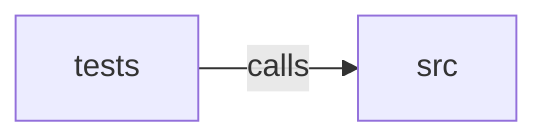

_Generated by CodeAtlas._

## Details

Owns 0 symbols across 1 file(s).

### src

Owns 21 symbols across 2 file(s).

**Related Classes/Methods:** _None_

**Source Files:**

- `crates/contextfold-parsers/src/langspec.rs`
  - `crates.contextfold-parsers.src.langspec.LangSpec`
  - `crates.contextfold-parsers.src.langspec.LangSpec.all`
  - `crates.contextfold-parsers.src.langspec.go`
  - `crates.contextfold-parsers.src.langspec.javascript`
  - `crates.contextfold-parsers.src.langspec.python`
  - `crates.contextfold-parsers.src.langspec.rust`
  - `crates.contextfold-parsers.src.langspec.tsx`
  - `crates.contextfold-parsers.src.langspec.typescript`
- `crates/contextfold-parsers/src/lib.rs`
  - `crates.contextfold-parsers.src.lib.TreeSitterAnalyzer`
  - `crates.contextfold-parsers.src.lib.TreeSitterAnalyzer.analyze`
  - `crates.contextfold-parsers.src.lib.TreeSitterAnalyzer.extensions`
  - `crates.contextfold-parsers.src.lib.TreeSitterAnalyzer.language`
  - `crates.contextfold-parsers.src.lib.TreeSitterAnalyzer.make_declaration`
  - `crates.contextfold-parsers.src.lib.TreeSitterAnalyzer.new`
  - `crates.contextfold-parsers.src.lib.TreeSitterAnalyzer.parse`
  - `crates.contextfold-parsers.src.lib.TreeSitterAnalyzer.visit`
  - `crates.contextfold-parsers.src.lib.python_docstring_of`
  - `crates.contextfold-parsers.src.lib.standard_engine`
  - `crates.contextfold-parsers.src.lib.standard_registry`
  - `crates.contextfold-parsers.src.lib.supported_code_languages`
  - `crates.contextfold-parsers.src.lib.ts_language_for`

### tests

Owns 17 symbols across 1 file(s).

**Related Classes/Methods:** _None_

**Source Files:**

- `crates/contextfold-parsers/tests/parsing.rs`
  - `crates.contextfold-parsers.tests.parsing.budget_is_reported_as_bytes_not_tokens`
  - `crates.contextfold-parsers.tests.parsing.determinism_end_to_end`
  - `crates.contextfold-parsers.tests.parsing.empty_input_is_handled`
  - `crates.contextfold-parsers.tests.parsing.fixture`
  - `crates.contextfold-parsers.tests.parsing.fold`
  - `crates.contextfold-parsers.tests.parsing.javascript_typescript_go_remove_comments`
  - `crates.contextfold-parsers.tests.parsing.js_interface_only_elides_body`
  - `crates.contextfold-parsers.tests.parsing.json_is_minified`
  - `crates.contextfold-parsers.tests.parsing.logs_profile_collapses_repeats`
  - `crates.contextfold-parsers.tests.parsing.malformed_python_fails_safe`
  - `crates.contextfold-parsers.tests.parsing.markdown_documentation_profile_dedupes`
  - `crates.contextfold-parsers.tests.parsing.protected_marker_line_survives`
  - `crates.contextfold-parsers.tests.parsing.python_interface_only_elides_bodies_and_stays_valid`
  - `crates.contextfold-parsers.tests.parsing.python_safe_preserves_docstrings_and_imports_removes_comments`
  - `crates.contextfold-parsers.tests.parsing.rust_safe_removes_comments_preserves_functions`
  - `crates.contextfold-parsers.tests.parsing.unicode_is_handled`
  - `crates.contextfold-parsers.tests.parsing.unknown_format_is_left_unchanged`
