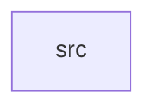

_Generated by CodeAtlas._

## Details

Owns 0 symbols across 1 file(s).

### src

Owns 48 symbols across 1 file(s).

**Related Classes/Methods:** _None_

**Source Files:**

- `crates/contextfold-py/src/lib.rs`
  - `crates.contextfold-py.src.lib.PyEngine`
  - `crates.contextfold-py.src.lib.PyEngine.fold`
  - `crates.contextfold-py.src.lib.PyEngine.fold_file`
  - `crates.contextfold-py.src.lib.PyEngine.fold_request`
  - `crates.contextfold-py.src.lib.PyEngine.new`
  - `crates.contextfold-py.src.lib.PyFoldRequest`
  - `crates.contextfold-py.src.lib.PyFoldRequest.__repr__`
  - `crates.contextfold-py.src.lib.PyFoldRequest.new`
  - `crates.contextfold-py.src.lib.PyFoldRequest.to_core`
  - `crates.contextfold-py.src.lib.PyFoldResult`
  - `crates.contextfold-py.src.lib.PyFoldResult.__repr__`
  - `crates.contextfold-py.src.lib.PyFoldResult.lossy`
  - `crates.contextfold-py.src.lib.PyFoldResult.report`
  - `crates.contextfold-py.src.lib.PyReport`
  - `crates.contextfold-py.src.lib.PyReport.__repr__`
  - `crates.contextfold-py.src.lib.PyReport.behavior_preserving`
  - `crates.contextfold-py.src.lib.PyReport.detected_language`
  - `crates.contextfold-py.src.lib.PyReport.engine_version`
  - `crates.contextfold-py.src.lib.PyReport.input_bytes`
  - `crates.contextfold-py.src.lib.PyReport.input_chars`
  - `crates.contextfold-py.src.lib.PyReport.input_lines`
  - `crates.contextfold-py.src.lib.PyReport.output_bytes`
  - `crates.contextfold-py.src.lib.PyReport.output_chars`
  - `crates.contextfold-py.src.lib.PyReport.output_lines`
  - `crates.contextfold-py.src.lib.PyReport.parse_status`
  - `crates.contextfold-py.src.lib.PyReport.profile`
  - `crates.contextfold-py.src.lib.PyReport.profile_version`
  - `crates.contextfold-py.src.lib.PyReport.protected_bytes`
  - `crates.contextfold-py.src.lib.PyReport.reduction_ratio`
  - `crates.contextfold-py.src.lib.PyReport.semantic_equivalence`
  - `crates.contextfold-py.src.lib.PyReport.syntax_valid`
  - `crates.contextfold-py.src.lib.PyReport.to_dict`
  - `crates.contextfold-py.src.lib.PyReport.to_json`
  - `crates.contextfold-py.src.lib.PyTokenizer`
  - `crates.contextfold-py.src.lib.PyTokenizer.count`
  - `crates.contextfold-py.src.lib.PyTokenizer.name`
  - `crates.contextfold-py.src.lib._core`
  - `crates.contextfold-py.src.lib.build_overrides`
  - `crates.contextfold-py.src.lib.detect_language`
  - `crates.contextfold-py.src.lib.fold`
  - `crates.contextfold-py.src.lib.fold_file`
  - `crates.contextfold-py.src.lib.into_result`
  - `crates.contextfold-py.src.lib.json_to_py`
  - `crates.contextfold-py.src.lib.map_engine_error`
  - `crates.contextfold-py.src.lib.parse_language`
  - `crates.contextfold-py.src.lib.profile_info`
  - `crates.contextfold-py.src.lib.profiles`
  - `crates.contextfold-py.src.lib.supported_languages`
