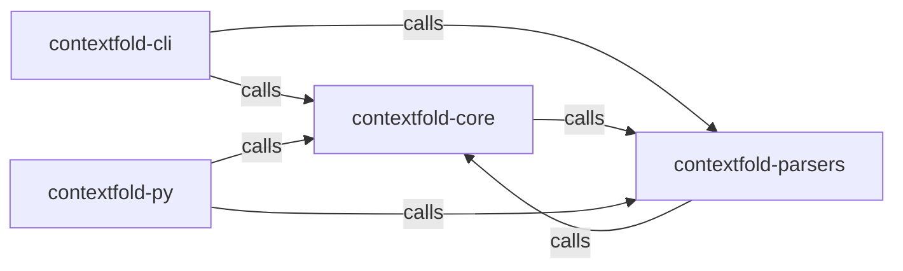

_Generated by CodeAtlas._

## Details

Owns 0 symbols across 0 file(s).

### contextfold-cli

Owns 0 symbols across 1 file(s).

**Related Classes/Methods:** _None_

### contextfold-core

Owns 0 symbols across 1 file(s).

**Related Classes/Methods:** _None_

### contextfold-parsers

Owns 0 symbols across 1 file(s).

**Related Classes/Methods:** _None_

### contextfold-py

Owns 0 symbols across 1 file(s).

**Related Classes/Methods:** _None_
