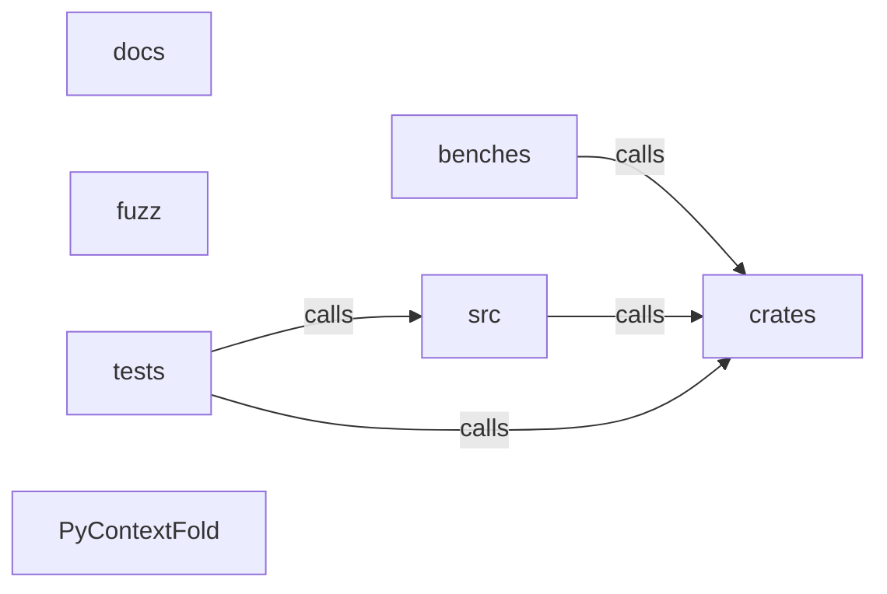

_Generated by CodeAtlas._

## Details

Architecture map of PyContextFold.

### benches

Owns 0 symbols across 0 file(s).

**Related Classes/Methods:** _None_

### crates

Owns 0 symbols across 0 file(s).

**Related Classes/Methods:** _None_

### docs

Owns 0 symbols across 9 file(s).

**Related Classes/Methods:** _None_

### fuzz

Owns 0 symbols across 2 file(s).

**Related Classes/Methods:** _None_

### src

Owns 0 symbols across 0 file(s).

**Related Classes/Methods:** _None_

### tests

Owns 26 symbols across 1 file(s).

**Related Classes/Methods:** _None_

**Source Files:**

- `tests/test_api.py`
  - `tests.test_api._WhitespaceTokenizer`
  - `tests.test_api._WhitespaceTokenizer.count`
  - `tests.test_api.fixture`
  - `tests.test_api.test_budget_bytes_is_approximate_not_tokens`
  - `tests.test_api.test_budget_tokens_requires_tokenizer`
  - `tests.test_api.test_caller_supplied_tokenizer`
  - `tests.test_api.test_detect_language_by_extension`
  - `tests.test_api.test_empty_input`
  - `tests.test_api.test_fold_file_does_not_modify_source`
  - `tests.test_api.test_fold_interface_only_is_lossy_and_valid`
  - `tests.test_api.test_fold_safe_removes_comments_preserves_docstrings`
  - `tests.test_api.test_json_minified`
  - `tests.test_api.test_logs_profile_collapses_repeats`
  - `tests.test_api.test_malformed_input_fails_safe`
  - `tests.test_api.test_markdown_documentation_profile`
  - `tests.test_api.test_profile_info`
  - `tests.test_api.test_profiles_listing`
  - `tests.test_api.test_protected_marker_line_survives`
  - `tests.test_api.test_protected_ranges_are_respected`
  - `tests.test_api.test_report_to_dict_and_json`
  - `tests.test_api.test_supported_languages`
  - `tests.test_api.test_typed_request_and_engine`
  - `tests.test_api.test_unicode_roundtrip`
  - `tests.test_api.test_unknown_language_raises`
  - `tests.test_api.test_unknown_profile_raises`
  - `tests.test_api.test_version_is_exposed`

### PyContextFold

Owns 0 symbols across 13 file(s).

**Related Classes/Methods:** _None_
