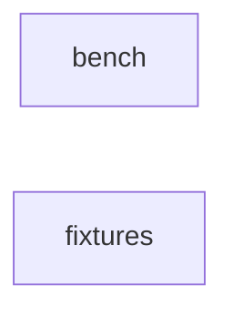

_Generated by CodeAtlas._

## Details

Owns 26 symbols across 1 file(s).

### bench

Owns 203 symbols across 14 file(s).

**Related Classes/Methods:** _None_

**Source Files:**

- `tests/bench/test_adapters.py`
  - `tests.bench.test_adapters.test_adapter_info_for_optional_dependency`
  - `tests.bench.test_adapters.test_adapter_info_for_optional_dependency.NeedsMissing`
  - `tests.bench.test_adapters.test_base_adapter_optimize_raises`
  - `tests.bench.test_adapters.test_base_adapter_optimize_raises.Empty`
  - `tests.bench.test_adapters.test_baseline_chunks`
  - `tests.bench.test_adapters.test_baseline_is_identity`
  - `tests.bench.test_adapters.test_baseline_rejects_unknown_chunker`
  - `tests.bench.test_adapters.test_contextfold_optimizes_and_reports`
  - `tests.bench.test_adapters.test_default_registry_has_builtins`
  - `tests.bench.test_adapters.test_registry_find_by_capability`
  - `tests.bench.test_adapters.test_registry_register_and_lookup`
  - `tests.bench.test_adapters.test_registry_rejects_duplicate`
  - `tests.bench.test_adapters.test_registry_replace`
  - `tests.bench.test_adapters.test_registry_requires_name`
  - `tests.bench.test_adapters.test_registry_requires_name.Nameless`
  - `tests.bench.test_adapters.test_registry_unknown_name`
- `tests/bench/test_capabilities.py`
  - `tests.bench.test_capabilities.test_duplicates_are_collapsed`
  - `tests.bench.test_capabilities.test_empty_set_is_falsy`
  - `tests.bench.test_capabilities.test_equality_with_plain_sets`
  - `tests.bench.test_capabilities.test_missing_and_supports`
  - `tests.bench.test_capabilities.test_of_and_membership`
  - `tests.bench.test_capabilities.test_rejects_non_capability`
  - `tests.bench.test_capabilities.test_union`
  - `tests.bench.test_capabilities.test_values_are_sorted_and_stable`
- `tests/bench/test_chunking.py`
  - `tests.bench.test_chunking.test_chunk_dispatch_and_unknown`
  - `tests.bench.test_chunking.test_empty_text_yields_no_chunks`
  - `tests.bench.test_chunking.test_fixed_bytes_never_splits_multibyte`
  - `tests.bench.test_chunking.test_fixed_chars_indices_and_sizes`
  - `tests.bench.test_chunking.test_fixed_chars_lossless_coverage`
  - `tests.bench.test_chunking.test_fixed_chars_rejects_bad_size`
  - `tests.bench.test_chunking.test_lines_grouping_lossless`
  - `tests.bench.test_chunking.test_paragraphs_group_and_cover`
  - `tests.bench.test_chunking.test_paragraphs_split_when_over_budget`
  - `tests.bench.test_chunking.test_registry_contains_expected`
- `tests/bench/test_cli.py`
  - `tests.bench.test_cli._write_config`
  - `tests.bench.test_cli.test_cli_adapters`
  - `tests.bench.test_cli.test_cli_datasets_print`
  - `tests.bench.test_cli.test_cli_datasets_write`
  - `tests.bench.test_cli.test_cli_gates_subcommand`
  - `tests.bench.test_cli.test_cli_missing_config_returns_usage_error`
  - `tests.bench.test_cli.test_cli_report_subcommand`
  - `tests.bench.test_cli.test_cli_run_gates_fail`
  - `tests.bench.test_cli.test_cli_run_gates_pass`
  - `tests.bench.test_cli.test_cli_run_writes_artifacts`
  - `tests.bench.test_cli.test_cli_unknown_dataset_returns_usage_error`
- `tests/bench/test_config.py`
  - `tests.bench.test_config._valid`
  - `tests.bench.test_config.test_config_from_dict`
  - `tests.bench.test_config.test_config_invalid_json`
  - `tests.bench.test_config.test_config_invalid_values_wrapped`
  - `tests.bench.test_config.test_config_json_round_trip`
  - `tests.bench.test_config.test_config_missing_required`
  - `tests.bench.test_config.test_config_not_a_mapping`
  - `tests.bench.test_config.test_load_config_json`
  - `tests.bench.test_config.test_load_config_sniff_json_without_suffix`
  - `tests.bench.test_config.test_load_config_toml`
- `tests/bench/test_dataset.py`
  - `tests.bench.test_dataset.test_dataset_from_dict_round_trip`
  - `tests.bench.test_dataset.test_dataset_json_round_trip`
  - `tests.bench.test_dataset.test_synthetic_dataset_has_expected_ids`
  - `tests.bench.test_dataset.test_synthetic_dataset_is_deterministic`
  - `tests.bench.test_dataset.test_synthetic_ground_truth_targets_exist`
  - `tests.bench.test_dataset.test_write_and_load_dataset`
- `tests/bench/test_ecosystem_adapters.py`
  - `tests.bench.test_ecosystem_adapters._install`
  - `tests.bench.test_ecosystem_adapters._module`
  - `tests.bench.test_ecosystem_adapters.test_all_ecosystem_adapters_registered`
  - `tests.bench.test_ecosystem_adapters.test_availability_reflects_injection`
  - `tests.bench.test_ecosystem_adapters.test_capability_lookup_for_ecosystem`
  - `tests.bench.test_ecosystem_adapters.test_openanchor_constructors`
  - `tests.bench.test_ecosystem_adapters.test_openanchor_constructors.Analytics`
  - `tests.bench.test_ecosystem_adapters.test_openanchor_constructors.TokenCollector`
  - `tests.bench.test_ecosystem_adapters.test_openanchor_constructors.TokenCollector.__init__`
  - `tests.bench.test_ecosystem_adapters.test_openanchor_missing_contract`
  - `tests.bench.test_ecosystem_adapters.test_pyagenthound_dict_metrics`
  - `tests.bench.test_ecosystem_adapters.test_pyagenthound_nested_evaluate`
  - `tests.bench.test_ecosystem_adapters.test_pyagenthound_tracer`
  - `tests.bench.test_ecosystem_adapters.test_pyagenthound_tracer.AgentHound`
  - `tests.bench.test_ecosystem_adapters.test_pyagenthound_tracer.AgentHound.__init__`
  - `tests.bench.test_ecosystem_adapters.test_pyapicheck_inventory_and_ground_truth`
  - `tests.bench.test_ecosystem_adapters.test_pyapicheck_object_items`
  - `tests.bench.test_ecosystem_adapters.test_pyapicheck_object_items.Item`
  - `tests.bench.test_ecosystem_adapters.test_pyapicheck_object_items.Item.__init__`
  - `tests.bench.test_ecosystem_adapters.test_pyinferencemanager_non_numeric_score`
  - `tests.bench.test_ecosystem_adapters.test_pyinferencemanager_non_numeric_score.Orchestrator`
  - `tests.bench.test_ecosystem_adapters.test_pyinferencemanager_non_numeric_score.Orchestrator.run`
  - `tests.bench.test_ecosystem_adapters.test_pyinferencemanager_score`
  - `tests.bench.test_ecosystem_adapters.test_pyinferencemanager_score.Orchestrator`
  - `tests.bench.test_ecosystem_adapters.test_pyinferencemanager_score.Orchestrator.run`
  - `tests.bench.test_ecosystem_adapters.test_pystreamai_complete_and_score`
  - `tests.bench.test_ecosystem_adapters.test_pystreamai_score_function`
  - `tests.bench.test_ecosystem_adapters.test_pystreammcp_discovery_registry`
  - `tests.bench.test_ecosystem_adapters.test_pystreammcp_discovery_registry.SourceRegistry`
  - `tests.bench.test_ecosystem_adapters.test_pystreammcp_discovery_registry.SourceRegistry.discover`
  - `tests.bench.test_ecosystem_adapters.test_pystreammcp_top_level_discover`
  - `tests.bench.test_ecosystem_adapters.test_pystreampdf_extract_and_chunk`
  - `tests.bench.test_ecosystem_adapters.test_pystreampdf_extract_and_chunk.Chunk`
  - `tests.bench.test_ecosystem_adapters.test_pystreampdf_extract_and_chunk.Chunk.__init__`
  - `tests.bench.test_ecosystem_adapters.test_pystreampdf_extract_and_chunk.Handle`
  - `tests.bench.test_ecosystem_adapters.test_pystreampdf_extract_and_chunk.SemanticChunker`
  - `tests.bench.test_ecosystem_adapters.test_pystreampdf_extract_and_chunk.SemanticChunker.__init__`
  - `tests.bench.test_ecosystem_adapters.test_pystreampdf_extract_and_chunk.SemanticChunker.chunk_content`
  - `tests.bench.test_ecosystem_adapters.test_pystreampdf_requires_text`
  - `tests.bench.test_ecosystem_adapters.test_pytokencalc_measurer`
  - `tests.bench.test_ecosystem_adapters.test_pytokencalc_missing`
  - `tests.bench.test_ecosystem_adapters.test_pyvectorhound_contract_missing`
  - `tests.bench.test_ecosystem_adapters.test_pyvectorhound_dict_metrics`
  - `tests.bench.test_ecosystem_adapters.test_pyvectorhound_object_metrics`
  - `tests.bench.test_ecosystem_adapters.test_pyvectorhound_object_metrics.Result`
  - `tests.bench.test_ecosystem_adapters.test_real_pytokencalc_optional`
  - `tests.bench.test_ecosystem_adapters.test_token_measurer_falls_back_when_absent`
  - `tests.bench.test_ecosystem_adapters.test_token_measurer_uses_pytokencalc_when_present`
- `tests/bench/test_gates.py`
  - `tests.bench.test_gates._run`
  - `tests.bench.test_gates.test_empty_gate_report_passes`
  - `tests.bench.test_gates.test_evaluate_gates_adapter_scope_ok`
  - `tests.bench.test_gates.test_evaluate_gates_adapter_scope_unknown_adapter`
  - `tests.bench.test_gates.test_evaluate_gates_fail_on_minimum`
  - `tests.bench.test_gates.test_evaluate_gates_pass`
  - `tests.bench.test_gates.test_evaluate_gates_unavailable_fails`
  - `tests.bench.test_gates.test_gate_report_to_dict`
  - `tests.bench.test_gates.test_threshold_check_bounds`
  - `tests.bench.test_gates.test_threshold_requires_a_bound`
  - `tests.bench.test_gates.test_thresholds_from_config`
  - `tests.bench.test_gates.test_thresholds_from_config_empty`
- `tests/bench/test_metrics.py`
  - `tests.bench.test_metrics._doc`
  - `tests.bench.test_metrics._result`
  - `tests.bench.test_metrics.test_aggregate_all_unavailable_stays_unavailable`
  - `tests.bench.test_metrics.test_aggregate_means_available_values`
  - `tests.bench.test_metrics.test_char_reduction`
  - `tests.bench.test_metrics.test_document_metrics_returns_five`
  - `tests.bench.test_metrics.test_drop_precision`
  - `tests.bench.test_metrics.test_drop_precision_unavailable_without_targets`
  - `tests.bench.test_metrics.test_metric_values_flatten`
  - `tests.bench.test_metrics.test_preservation_recall_all_kept`
  - `tests.bench.test_metrics.test_preservation_recall_partial`
  - `tests.bench.test_metrics.test_preservation_recall_unavailable_without_ground_truth`
  - `tests.bench.test_metrics.test_size_reduction_empty_input_is_zero`
  - `tests.bench.test_metrics.test_size_reduction_half`
  - `tests.bench.test_metrics.test_token_reduction_uses_measurer_and_reports_exactness`
- `tests/bench/test_models.py`
  - `tests.bench.test_models.test_dataset_get_missing_raises`
  - `tests.bench.test_models.test_dataset_lookup_and_round_trip`
  - `tests.bench.test_models.test_dataset_rejects_duplicate_ids`
  - `tests.bench.test_models.test_document_line_count_without_trailing_newline`
  - `tests.bench.test_models.test_document_requires_id`
  - `tests.bench.test_models.test_document_round_trip`
  - `tests.bench.test_models.test_document_sizes`
  - `tests.bench.test_models.test_experiment_config_round_trip`
  - `tests.bench.test_models.test_experiment_config_validation`
  - `tests.bench.test_models.test_ground_truth_round_trip`
  - `tests.bench.test_models.test_ground_truth_validates_reduction`
  - `tests.bench.test_models.test_metric_result_available_requires_value`
  - `tests.bench.test_models.test_metric_result_unavailable`
  - `tests.bench.test_models.test_optimization_result_requires_document_id`
  - `tests.bench.test_models.test_required_capabilities_for_metrics`
- `tests/bench/test_report.py`
  - `tests.bench.test_report._run`
  - `tests.bench.test_report.test_custom_title`
  - `tests.bench.test_report.test_failed_document_row_marked_unavailable`
  - `tests.bench.test_report.test_generated_at_is_optional_and_rendered`
  - `tests.bench.test_report.test_html_is_escaped`
  - `tests.bench.test_report.test_metadata_present`
  - `tests.bench.test_report.test_render_has_no_external_assets`
  - `tests.bench.test_report.test_render_is_deterministic`
  - `tests.bench.test_report.test_render_is_self_contained_html`
  - `tests.bench.test_report.test_render_metric_rows`
  - `tests.bench.test_report.test_unavailable_metrics_shown_as_na`
  - `tests.bench.test_report.test_write_report`
- `tests/bench/test_runner.py`
  - `tests.bench.test_runner._config`
  - `tests.bench.test_runner.test_adapter_error_is_isolated_per_document`
  - `tests.bench.test_runner.test_adapter_error_is_isolated_per_document.Flaky`
  - `tests.bench.test_runner.test_adapter_error_is_isolated_per_document.Flaky.optimize`
  - `tests.bench.test_runner.test_config_hash_and_dataset_hash_are_stable`
  - `tests.bench.test_runner.test_default_metrics_are_the_core_five`
  - `tests.bench.test_runner.test_limit_zero_yields_no_documents`
  - `tests.bench.test_runner.test_method_option_is_passed`
  - `tests.bench.test_runner.test_method_option_is_passed.Recorder`
  - `tests.bench.test_runner.test_method_option_is_passed.Recorder.optimize`
  - `tests.bench.test_runner.test_non_core_requested_metric_is_unavailable`
  - `tests.bench.test_runner.test_per_adapter_options_are_merged`
  - `tests.bench.test_runner.test_per_adapter_options_are_merged.Recorder`
  - `tests.bench.test_runner.test_per_adapter_options_are_merged.Recorder.optimize`
  - `tests.bench.test_runner.test_run_produces_one_adapter_run_per_adapter`
  - `tests.bench.test_runner.test_runner_uses_injected_measurer`
  - `tests.bench.test_runner.test_runner_uses_injected_measurer.counter`
  - `tests.bench.test_runner.test_seeded_limit_selects_deterministically`
  - `tests.bench.test_runner.test_unavailable_adapter_aggregate_metrics_are_unavailable`
  - `tests.bench.test_runner.test_unexpected_exception_is_isolated`
  - `tests.bench.test_runner.test_unexpected_exception_is_isolated.Exploding`
  - `tests.bench.test_runner.test_unexpected_exception_is_isolated.Exploding.optimize`
  - `tests.bench.test_runner.test_unregistered_adapter_is_unavailable_not_fatal`
- `tests/bench/test_runs.py`
  - `tests.bench.test_runs._sample_run`
  - `tests.bench.test_runs.test_adapter_run_counts_and_round_trip`
  - `tests.bench.test_runs.test_canonical_hash_is_order_independent`
  - `tests.bench.test_runs.test_document_run_metric_lookup`
  - `tests.bench.test_runs.test_document_run_rejects_bad_status`
  - `tests.bench.test_runs.test_document_run_round_trip`
  - `tests.bench.test_runs.test_run_result_adapter_lookup`
  - `tests.bench.test_runs.test_run_result_round_trip`
  - `tests.bench.test_runs.test_write_and_read_run`
- `tests/bench/test_tokens.py`
  - `tests.bench.test_tokens.test_approximate_is_not_exact`
  - `tests.bench.test_tokens.test_approximate_rejects_bad_ratio`
  - `tests.bench.test_tokens.test_callable_measurer_defaults_to_exact`
  - `tests.bench.test_tokens.test_callable_rejects_negative`
  - `tests.bench.test_tokens.test_count_tokens_validates`
  - `tests.bench.test_tokens.test_default_measurer_is_approximate`
  - `tests.bench.test_tokens.test_protocol_runtime_check`
  - `tests.bench.test_tokens.test_whitespace_counts_words`

### fixtures

Owns 22 symbols across 11 file(s).

**Related Classes/Methods:** _None_

**Source Files:**

- `tests/fixtures/malformed.py`
  - `tests.fixtures.malformed.broken`
- `tests/fixtures/sample.go`
  - `tests.fixtures.sample.(Point).Sum`
  - `tests.fixtures.sample.Add`
  - `tests.fixtures.sample.Guarded`
  - `tests.fixtures.sample.Point`
- `tests/fixtures/sample.js`
  - `tests.fixtures.sample.Calculator`
  - `tests.fixtures.sample.Calculator.add`
  - `tests.fixtures.sample.Calculator.constructor`
  - `tests.fixtures.sample.add`
  - `tests.fixtures.sample.identity`
- `tests/fixtures/sample.py`
  - `tests.fixtures.sample.Greeter`
  - `tests.fixtures.sample.Greeter.__init__`
  - `tests.fixtures.sample.Greeter.greet`
  - `tests.fixtures.sample.has_trailing_whitespace`
- `tests/fixtures/sample.rs`
  - `tests.fixtures.sample.Point.length`
  - `tests.fixtures.sample.Point.new`
  - `tests.fixtures.sample.guarded`
- `tests/fixtures/sample.ts`
  - `tests.fixtures.sample.Service`
  - `tests.fixtures.sample.Service.increment`
  - `tests.fixtures.sample.User`
  - `tests.fixtures.sample.greet`
- `tests/fixtures/unicode.py`
  - `tests.fixtures.unicode.f`
